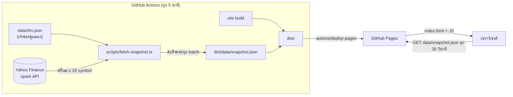

# Design: หน้ารวม DR ที่อ้างอิงหลักทรัพย์สหรัฐฯ พร้อม Premium/Discount

สถานะ: รอบหลัก (เฟส Design) · วันที่ 17 พ.ย. 2569 · อ้างอิง [`docs/01-prd.md`](01-prd.md)

## 1. ภาพรวม

ระบบมีสองส่วน ส่วนแรกคืองานตามรอบบน GitHub Actions ทุก 5 นาที ซึ่งดึงราคา DR ราคาหลักทรัพย์อ้างอิง และอัตราแลกเปลี่ยนจาก Yahoo Finance มารวมกับรายชื่อ DR ที่เจ้าของดูแลเองใน repo ได้เป็นไฟล์ `snapshot.json` หนึ่งไฟล์ แล้ว deploy ขึ้น GitHub Pages พร้อมหน้าเว็บ ส่วนที่สองคือหน้าเว็บ static ที่โหลด `snapshot.json` ทุก 30 วินาที แล้วคำนวณ fair value และ premium/discount จัดรูปแบบ เรียง ค้นหา และตัดสินแถบเตือนเองในเบราว์เซอร์ ระบบไม่มี server ของตัวเอง ไม่มี secret และไม่มีค่าใช้จ่าย



ถ้าดึงข้อมูล batch ใดไม่สำเร็จ งานรอบนั้นจะหยุดโดยไม่ deploy หน้าเว็บจึงยังแสดง snapshot ชุดเดิมพร้อม `fetchedAt` เดิม ตรงกับ AC-20

## 2. แหล่งข้อมูล

### 2.1 สรุปผลการเรียกจริง

เรียกจริงเมื่อ 17 พ.ย. 2569 10:15–11:05 (เวลาไทย) ระหว่างรอบกลางวันของ SET ทั้งจากเครื่องในเครือข่ายของเจ้าของ และจาก GitHub Actions (`ubuntu-latest`) ซึ่งเป็นที่ที่ระบบจะรันจริง

| ข้อมูล | แหล่ง | เรียกจาก | ผล | ใช้หรือไม่ |
|---|---|---|---|---|
| ราคา DR, ราคาหลักทรัพย์อ้างอิง, FX | Yahoo Finance spark API | GitHub Actions | HTTP 200 ครบทุกตัว ดูข้อ 2.2 | **ใช้** |
| เหมือนข้างบน | Yahoo Finance | เครือข่ายของเจ้าของ | HTTP 429 `Edge: Too Many Requests` ทุกครั้ง | ไม่ใช้เครือข่ายนี้ |
| ราคา DR | SET `www.set.or.th/api/set/stock/<DR>/info`, Settrade `www.settrade.com/api/...` | เครือข่ายของเจ้าของ | HTTP 403 จากระบบกันบอท (Incapsula) ไม่ได้พยายามหลบ | ไม่ใช้ |
| ราคา DR | SET Market Data API | ไม่ได้เรียก | เป็นบริการที่เสียค่าธรรมเนียมรายเดือน | ไม่ใช้ (ขัด NFR-10) |
| ราคา DR | TradingView scanner | เครือข่ายของเจ้าของ | HTTP 200 (`AAPL80` 11.95, `delayed_streaming_900`) แต่ TradingView ห้ามดึงข้อมูลอัตโนมัติทุกรูปแบบ | ไม่ใช้ (ขัด NFR-13) |
| ราคาหลักทรัพย์อ้างอิง | Cboe delayed quotes `cdn-api.cboe.com/api/global/delayed_quotes/quotes/<T>.json` | เครือข่ายของเจ้าของ | HTTP 200 ล่าช้า 15 นาที มี `close` ของช่วงปกติ ไม่มี CORS และหาเงื่อนไขการใช้งานไม่พบ | ไม่ใช้ (ใช้แหล่งเดียวกับราคา DR ง่ายกว่า) |
| ราคาหลักทรัพย์อ้างอิง | Nasdaq `api.nasdaq.com/api/quote/<T>/info` | เครือข่ายของเจ้าของ | HTTP 200 แต่ตอนเย็นวันจันทร์ (NY) ยังคืนราคาของวันศุกร์ `isRealTime:false` | ไม่ใช้ |
| FX | Coinbase `api.coinbase.com/v2/exchange-rates?currency=USD` | เครือข่ายของเจ้าของ | HTTP 200 THB 33.8216 แต่ไม่มีเวลาของอัตรา | ไม่ใช้ |
| FX | Frankfurter (ECB), open.er-api.com | เครือข่ายของเจ้าของ | HTTP 200 (33.89 และ 33.8868) อัปเดตวันละครั้ง | ไม่ใช้ |
| รายชื่อ DR, ผู้ออก, อัตราส่วน | ไม่พบแหล่งฟรี | – | ข้อมูลอ้างอิงของ SET มีให้เฉพาะ vendor ที่มีใบอนุญาต | ใช้ `data/drs.json` (ข้อ 2.3) |

ตัวเลขชุดนี้สอดคล้องกัน: `AAPL` 352.78 × (1 ÷ 1000) × 33.79 = 11.92 บาท ส่วน `AAPL80` ซื้อขายที่ 11.90 บาท

### 2.2 Yahoo Finance spark API (ราคาทั้งสามประเภท)

- **URL:** `GET https://query1.finance.yahoo.com/v7/finance/spark?symbols=<s1>,<s2>,…&range=1d&interval=1d`
- **Symbol ที่ใช้:**
  - DR: `<ชื่อ DR>.BK` เช่น `AAPL80.BK`
  - หลักทรัพย์อ้างอิง: ticker ของ Yahoo เช่น `AAPL`, `GLD`, `BRK-B`
  - FX: `THB=X` (บาทต่อ 1 USD)
- **Field ที่ใช้** (ต่อหนึ่ง symbol): `spark.result[].symbol`, `spark.result[].response[0].meta.regularMarketPrice` และ `spark.result[].response[0].meta.regularMarketTime` (วินาที Unix) ไม่ใช้ field อื่น
- **ไม่ต้องใช้ API key** ส่ง header `User-Agent` แบบทั่วไป ตอนทดสอบใช้ `Mozilla/5.0`
- **ข้อจำกัดที่วัดได้:**
  - ครั้งละไม่เกิน 20 symbol ถ้าเกินจะได้ HTTP 400 พร้อม `"Number of symbols needs to be less than or equal to 20"`
  - symbol ที่ไม่มีอยู่จะถูกตัดออกจากผลเงียบๆ (ทดสอบด้วย `NOPE99.BK`)
  - เรียกต่อเนื่อง 25 ครั้งจาก GitHub Actions ไม่โดนจำกัด Yahoo ไม่ได้ประกาศ rate limit
- **CORS:** ไม่ได้ใช้ เพราะเรียกจาก GitHub Actions เท่านั้น เบราว์เซอร์ไม่ได้เรียก Yahoo

**ตัวอย่างคำตอบจริง** (รวมจากสองคำตอบเมื่อ 17 พ.ย. 2569 ตัดเหลือเฉพาะ field ที่ใช้และ field ที่ช่วยอ่าน):

```json
{
  "spark": {
    "result": [
      { "symbol": "AAPL80.BK", "response": [{ "meta": { "symbol": "AAPL80.BK", "currency": "THB", "exchangeName": "SET", "regularMarketPrice": 11.9, "regularMarketTime": 1794885530 } }] },
      { "symbol": "AAPL", "response": [{ "meta": { "symbol": "AAPL", "currency": "USD", "exchangeName": "NMS", "regularMarketPrice": 352.78, "regularMarketTime": 1794862801 } }] },
      { "symbol": "THB=X", "response": [{ "meta": { "symbol": "THB=X", "currency": "THB", "exchangeName": "CCY", "regularMarketPrice": 33.79, "regularMarketTime": 1794887896 } }] }
    ],
    "error": null
  }
}
```

เวลาในตัวอย่าง:
- `AAPL80.BK` ที่ `1794885530` คือ 17 พ.ย. 2569 10:18:50 เวลาไทย
- `AAPL` ที่ `1794862801` คือ 16 พ.ย. 16:00:01 เวลานิวยอร์ก ตรงกับ 17 พ.ย. 04:00 เวลาไทย
- `THB=X` ที่ `1794887896` คือ 10:58:16 เวลาไทย ห่างจากเวลาที่เรียกเพียง 4 วินาที

**สิ่งที่ยืนยันแล้ว:**
- `regularMarketPrice` ของหุ้นสหรัฐฯ เป็นราคาช่วงปกติ ไม่ใช่ after-hours (AC-14)
  - ตอน 22:58 เวลานิวยอร์ก Yahoo ให้ `AAPL` 352.78 ขณะที่ Cboe ให้ราคาล่าสุด 353.611 ซึ่งเป็นราคา after-hours และให้ `close` 352.78
  - `BABA` เป็นแบบเดียวกัน คือ Yahoo ให้ 90.62 ส่วนราคา after-hours ของ Cboe คือ 90.95
- มี ETF และ ADR ด้วย: `GLD` (exchangeName `PCX` = NYSE Arca), `QQQ` (`NGM`), `BABA` (`NYQ` = NYSE), `BRK-B` (`NYQ`)
- มี DR หลายผู้ออกของหลักทรัพย์ตัวเดียวกัน: `NVDA01`, `NVDA03`, `NVDA06`, `NVDA19`, `NVDA80` และ `GOLD19`

**ความล่าช้าที่วัดได้** (ใช้ตอบ NFR-1, NFR-3 และ NFR-4):

| ข้อมูล | ความล่าช้าจาก Yahoo | วิธีวัด |
|---|---|---|
| ราคา DR รอบกลางวัน | **ประมาณ 30 นาที** | `NVDA80` ซื้อขายเกือบทุกนาที (23 จาก 25 นาทีแรก) แต่แท่ง 1 นาทีสุดท้ายที่ได้คือ 10:24 ตอนเรียกเวลา 10:55 วัดซ้ำได้ 30.2 นาที |
| ราคา DR รอบกลางคืน | **ไม่มีข้อมูลเลย** | แท่ง 5 นาทีย้อนหลัง 5 วันของ `NVDA80` และ `AAPL80` (11–17 พ.ย.) มีเฉพาะ 10:00–16:59 ไม่มีแท่งในช่วง 19:00–03:00 แม้แต่แท่งเดียว ทั้งแบบ `includePrePost=false` และ `true` |
| ราคาหลักทรัพย์อ้างอิง | ยังไม่ได้วัด | ตอนทดสอบตลาดสหรัฐฯ ปิดอยู่ (ดูข้อ 9 R5) |
| FX | 4–6 วินาที | เทียบ `regularMarketTime` กับเวลาที่เรียก |

**เงื่อนไขการใช้งานและความเสี่ยง:**
- Yahoo อนุญาตให้ใช้ข้อมูลเพื่อการส่วนตัวที่ไม่ใช่เชิงพาณิชย์ และห้ามใช้ปริมาณมากโดยไม่ได้รับอนุญาต API นี้ไม่มีเอกสารทางการ จึงเปลี่ยนหรือปิดได้ทุกเมื่อ
- การนำไปแสดงบนเว็บสาธารณะจึง**ไม่เป็นไปตาม NFR-13** เจ้าของผลิตภัณฑ์เลือกยอมรับความเสี่ยงนี้แล้ว (ทางเลือก 1.ก ระหว่างเฟส Design)
- SET กำหนดให้ข้อมูลที่ล่าช้าต้องระบุว่าล่าช้า หน้าเว็บจึงมีข้อความที่มาของข้อมูล (ข้อ 5.5 `source-note`) เพื่อตอบคำถามข้อ 6 ของ PRD

### 2.3 `data/drs.json`: รายชื่อ DR และอัตราส่วน (เจ้าของดูแลเอง)

ไม่มีแหล่งฟรีที่ให้รายชื่อ DR พร้อมผู้ออก อัตราส่วน และหลักทรัพย์อ้างอิง จึงเก็บเป็นไฟล์ใน repo ที่เจ้าของผลิตภัณฑ์ดูแลและแก้ผ่าน PR ไฟล์นี้เป็นทั้ง "รายชื่อ DR ที่จดทะเบียนอยู่" (AC-6, AC-7) และที่จับคู่ DR กับ ticker สหรัฐฯ (คำถามข้อ 8 ของ PRD)

```json
[
  {
    "symbol": "AAPL80",
    "issuer": "KTB",
    "underlying": { "symbol": "AAPL", "name": "Apple Inc.", "market": "NASDAQ" },
    "ratios": [
      { "drUnits": 1000, "underlyingUnits": 1, "effectiveFrom": null }
    ]
  },
  {
    "symbol": "GOLD19",
    "issuer": "YUANTA",
    "underlying": { "symbol": "GLD", "name": "SPDR Gold Trust", "market": "NYSE Arca" },
    "ratios": [
      { "drUnits": 100, "underlyingUnits": 1, "effectiveFrom": null },
      { "drUnits": 50, "underlyingUnits": 1, "effectiveFrom": "2026-12-01" }
    ]
  }
]
```

ตัวเลขข้างบนเป็นตัวอย่างรูปแบบ ไม่ใช่อัตราส่วนจริง

| Field | ความหมาย |
|---|---|
| `symbol` | ชื่อ DR ไม่ซ้ำกัน ใช้ต่อท้าย `.BK` เมื่อเรียก Yahoo |
| `issuer` | ชื่อย่อผู้ออกที่แสดงในคอลัมน์ "ผู้ออก" |
| `underlying.symbol` | ticker ที่แสดงในตาราง และใช้เรียก Yahoo |
| `underlying.quoteSymbol` | ใส่เฉพาะเมื่อ symbol ของ Yahoo ต่างจากที่แสดง เช่น แสดง `BRK.B` แต่เรียก `BRK-B` |
| `underlying.name` | ชื่อที่แสดงในคอลัมน์ "ชื่อหลักทรัพย์อ้างอิง" |
| `underlying.market` | ชื่อตลาดที่แสดง ค่าที่นับเป็นตลาดสหรัฐฯ คือ `US_MARKETS` = `NASDAQ`, `NYSE`, `NYSE Arca`, `NYSE American`, `Cboe BZX` ถ้าเป็นค่าอื่น เช่น `HKEX` จะไม่แสดงในตาราง |
| `ratios[]` | อัตราส่วน `drUnits : underlyingUnits` (จำนวนบวก) และ `effectiveFrom` คือวันซื้อขายสหรัฐฯ แรกที่มีผล (`YYYY-MM-DD` ตามเวลานิวยอร์ก) หรือ `null` ถ้ามีผลตั้งแต่จดทะเบียน มี `null` ได้ไม่เกินหนึ่งรายการ |

กติกาการดูแลไฟล์:
- **เพิ่ม DR ใหม่:** เพิ่มรายการใหม่
- **DR ถูกเพิกถอน:** ลบรายการออก (AC-7)
- **ผู้ออกประกาศเปลี่ยนอัตราส่วน:** เพิ่มรายการใน `ratios` พร้อม `effectiveFrom` ก่อนถึงวันนั้น
- **ล้างรายการเก่า:** ลบรายการเก่าได้หลังวันมีผลผ่านไปแล้ว เพราะการเก็บประวัติอัตราส่วนอยู่นอกขอบเขต
- **ไฟล์ผิดรูปแบบ:** `scripts/fetch-snapshot.ts` ตรวจรูปแบบทุกรอบ ถ้าผิด งานรอบนั้นจะหยุดโดยไม่ deploy และ GitHub จะแจ้งเจ้าของทางอีเมลว่า workflow ล้มเหลว

### 2.4 ความสดของข้อมูล (NFR-1 ถึง NFR-4)

| ข้อมูล | ล่าช้าจากแหล่ง | + รอบดึงและ deploy | ล่าช้ารวมโดยประมาณ | NFR-1 (≤ 1 นาที) | NFR-3 (≤ 20 นาที) |
|---|---|---|---|---|---|
| ราคา DR รอบกลางวัน | ~30 นาที (วัดจริง) | 5–15 นาที | 35–45 นาที | ไม่ได้ | **ไม่ได้** |
| ราคา DR รอบกลางคืน | ไม่มีข้อมูล ราคาค้างที่การซื้อขายสุดท้ายของรอบกลางวัน | – | ถึง 10 ชั่วโมงครึ่ง | ไม่ได้ | **ไม่ได้** |
| ราคาหลักทรัพย์อ้างอิง | ยังไม่ได้วัด (สมมติว่าเกือบ real-time) | 5–15 นาที | 5–15 นาที | ไม่ได้ | ได้ ถ้าสมมติฐานถูก |
| FX | ~5 วินาที (วัดจริง) | 5–15 นาที | 5–15 นาที | ไม่ได้ | ได้ |

- "รอบดึงและ deploy" มาจาก cron ทุก 5 นาที ซึ่งเป็นช่วงสั้นที่สุดที่ GitHub รองรับ เอกสารของ GitHub บอกว่าอาจเลื่อนช่วงที่มีงานรอมาก โดยเฉพาะต้นชั่วโมง และอาจทิ้งบางรอบ บวกเวลา build และ deploy Pages ราว 1–2 นาที ตัวเลข 5–15 นาทีเป็นค่าประมาณจากเอกสาร ยังไม่ได้วัด
- ตาม NFR-3 ราคา DR ทำได้แย่กว่า 20 นาที **เจ้าของผลิตภัณฑ์ต้องตัดสินใหม่ที่ gate นี้** (ข้อ 9 R1, R2)
- NFR-4: ด้วยรอบที่เลื่อนได้แบบนี้ "อัปเดตสำเร็จครั้งล่าสุด" จะเก่ากว่า 5 นาทีเป็นประจำ แถบเตือนตาม AC-22 จึงจะขึ้นเกือบตลอดเวลาซื้อขาย ข้อ 9 R3 เสนอให้แก้เกณฑ์ใน PRD design นี้ใช้ค่า 5 นาทีตาม PRD ปัจจุบันไปก่อน (`STALE_AFTER_MS`)
- NFR-2: หน้าเว็บโหลด snapshot ทุก 30 วินาที (`POLL_INTERVAL_MS`)

### 2.5 คำตอบคำถามที่ PRD ส่งต่อให้ Design (PRD ข้อ 8)

| # | คำถาม | คำตอบ |
|---|---|---|
| 1 | รายชื่อ DR, ผู้ออก, อัตราส่วน, การแยก DR สหรัฐฯ, วันมีผลของอัตราส่วน | ไม่มีแหล่งฟรี ใช้ `data/drs.json` แยกด้วย `underlying.market` และระบุวันมีผลด้วย `effectiveFrom` (ข้อ 2.3) |
| 2 | ราคา DR และเวลา ทั้งสองรอบ | Yahoo spark `<DR>.BK` มีเฉพาะรอบกลางวัน ล่าช้าประมาณ 30 นาที **ไม่มีรอบกลางคืน** |
| 3 | ราคาหลักทรัพย์อ้างอิง แยกช่วงปกติ และเวลา | Yahoo spark `regularMarketPrice` / `regularMarketTime` เป็นราคาช่วงปกติ ยืนยันกับราคา after-hours ของ Cboe แล้ว |
| 4 | FX กลางตลาดพร้อมเวลา | Yahoo `THB=X` มีเวลา แต่ยังไม่ได้ยืนยันว่าเป็นค่ากลางหรือราคาเสนอซื้อ (ข้อ 9 R6) |
| 5 | ความสด | ข้อ 2.4 |
| 6 | เงื่อนไขการใช้งาน, rate limit, การแสดงที่มา | ข้อ 2.2 ไม่เป็นไปตาม NFR-13 และเจ้าของยอมรับแล้ว ครั้งละ ≤ 20 symbol หน้าเว็บแสดงที่มาและความล่าช้า |
| 7 | นิยาม "อัปเดตสำเร็จ" | รอบที่ทุก batch ได้ HTTP 200 และ JSON ถูกรูปแบบ symbol ที่ไม่มีในผลนับเป็นข้อมูลขาด ไม่ใช่ความล้มเหลว จึงไม่ทำให้แถบเตือนขึ้นเพราะ DR ตัวเดียว (ข้อ 8 D8) |
| 8 | จับคู่ DR กับ ticker เช่น `GOLD19` → `GLD` | กำหนดใน `data/drs.json` (`underlying.symbol` และ `quoteSymbol`) |

## 3. Stack และ toolchain

| ส่วน | เลือก | เวอร์ชัน |
|---|---|---|
| Runtime (งานดึงข้อมูล, build, test) | Node.js LTS "Lithium" รัน `.ts` ได้โดยตรง (type stripping) | 26.x (26.13.1 ณ 10 พ.ย. 2569), `engines: ">=26"` |
| ภาษา | TypeScript | 7.0.x |
| Package manager | npm (มากับ Node) พร้อม `package-lock.json` | 11.x |
| หน้าเว็บ | TypeScript ล้วน ไม่มี framework, build ด้วย Vite | Vite 8.3.x |
| Test: logic | Vitest | 5.1.x |
| Test: UI | Playwright Test (Chromium) | 1.65.x |
| Hosting | GitHub Pages ผ่าน `actions/deploy-pages` | – |
| ตามรอบ | GitHub Actions `schedule` ทุก 5 นาที | – |

- ไม่มี runtime dependency มีเฉพาะ devDependency: `typescript`, `vite`, `vitest`, `@playwright/test`, `@types/node`
- `tsconfig.json` ใช้ `strict`, `noEmit`, `allowImportingTsExtensions`, `verbatimModuleSyntax` และ `erasableSyntaxOnly` เพื่อให้ Node รัน `.ts` ได้ตรงๆ และใช้ไฟล์เดียวกับ Vite ได้
- import ภายในโปรเจกต์ใส่นามสกุล `.ts` เสมอ

## 4. โครงสร้างโมดูล

```
index.html                 entry ของหน้าเว็บ (Vite)
src/
  domain/                  logic ล้วน ไม่แตะ DOM, network หรือนาฬิกาของเครื่อง
    types.ts               type ทั้งหมดในข้อ 5.2
    calc.ts                อัตราส่วน r, fair value, premium, วันซื้อขายสหรัฐฯ, เลือกอัตราส่วน, ราคาไม่พร้อมกัน
    format.ts              จัดรูปแบบตัวเลข เปอร์เซ็นต์ และเวลาไทย
    rows.ts                buildRows, toDisplayRow
    freshness.ts           เวลาซื้อขาย (AC-23) และการตัดสินแถบเตือน (AC-22)
    table.ts               เรียง (AC-9 ถึง AC-11) และค้นหา (AC-12)
    index.ts               export ที่ acceptance test ใช้ (ข้อ 5.3)
  data/
    yahoo.ts               parseSpark, fetchSnapshot (รับ fetch จากภายนอก)
  ui/
    main.ts                โหลด snapshot ทุก 30 วินาที, state ของคำค้นและการเรียง, render ตาราง
    style.css              layout รวมถึงจอ 360px
scripts/
  fetch-snapshot.ts        CLI: ตรวจ data/drs.json → fetchSnapshot → เขียนไฟล์ snapshot
data/
  drs.json                 รายชื่อ DR (ข้อ 2.3)
tests/
  acceptance/              เฟส Acceptance Test เท่านั้น (ข้อ 5.6)
```

- **คำนวณในเบราว์เซอร์:** งานดึงข้อมูลเก็บราคาดิบใน snapshot ส่วนการคำนวณ การจัดรูปแบบ การเรียง การค้นหา และแถบเตือนทำในเบราว์เซอร์ เพราะแถบเตือนต้องใช้ "ตอนนี้" ของเครื่องผู้ใช้อยู่แล้ว และ snapshot ก็เป็น fixture ตัวเดียวที่ UI test ต้องใช้
- **unit test:** อยู่ข้างโค้ดเป็น `src/**/*.test.ts` ซึ่งเฟส Implement เขียน

## 5. Test interface

### 5.1 ระดับของ test

| ระดับ | ทดสอบอะไร | Runner | ขอบเขตข้อมูล |
|---|---|---|---|
| Domain | การคำนวณ ข้อความที่แสดงในแต่ละเซลล์ เหตุผลที่ข้อมูลขาด ป้าย และการตัดสินแถบเตือน | Vitest | สร้าง `Snapshot` ใน test แล้วเรียกฟังก์ชันในข้อ 5.3 |
| Data | การอ่านคำตอบของ Yahoo และนิยาม "อัปเดตสำเร็จ" | Vitest | `fetch` ปลอมที่คืน JSON รูปแบบ spark (ข้อ 5.4.2) |
| UI | หน้าเว็บจริงใน Chromium: คอลัมน์ การเรียง การค้นหา การอัปเดตเอง แถบเตือน และจอ 360px | Playwright | ดัก `**/data/snapshot.json*` ด้วย `page.route` แล้วตอบด้วย `Snapshot` (ข้อ 5.4.1) |

ไม่มี test ไหนเรียก network จริง เวลา "ตอนนี้" มาจากพารามิเตอร์ (domain) หรือ `page.clock` (UI)

### 5.2 Type (`src/domain/types.ts`)

```ts
export interface RatioEntry {
  drUnits: number;              // a ใน "a : b"
  underlyingUnits: number;      // b ใน "a : b"
  effectiveFrom: string | null; // วันซื้อขายสหรัฐฯ 'YYYY-MM-DD' หรือ null = ตั้งแต่จดทะเบียน
}

export interface DrRef {
  symbol: string;               // 'AAPL80'
  issuer: string;               // 'KTB'
  underlying: {
    symbol: string;             // 'AAPL' (แสดงผล และ key ของ underlyingQuotes)
    quoteSymbol?: string;       // symbol ของ Yahoo เมื่อต่างจาก symbol
    name: string;               // 'Apple Inc.'
    market: string;             // 'NASDAQ' | 'NYSE' | 'NYSE Arca' | ... | 'HKEX'
  };
  ratios: RatioEntry[];
}

export interface Quote {
  price: number;                // บาท (DR), USD (หลักทรัพย์อ้างอิง) หรือบาทต่อ 1 USD (FX)
  time: string;                 // ISO 8601 พร้อม offset เช่น '2026-11-03T03:15:00Z'
}

export interface Snapshot {
  fetchedAt: string;                         // ISO 8601: เวลาที่ดึงครบทุกแหล่งสำเร็จ
  drs: DrRef[];                              // รายชื่อ DR ที่จดทะเบียนอยู่ (ยังไม่กรองตลาด)
  drQuotes: Record<string, Quote>;           // key = DR symbol ('AAPL80') ไม่มี key = ยังไม่มีการซื้อขาย
  underlyingQuotes: Record<string, Quote>;   // key = underlying.symbol ('AAPL') ราคาช่วงปกติเท่านั้น
  fx: Quote | null;                          // USD/THB หรือ null ถ้าไม่มี
}

export type MissingReason =
  | 'ยังไม่มีการซื้อขาย'
  | 'ไม่มีราคาหลักทรัพย์อ้างอิง'
  | 'ไม่มีอัตราแลกเปลี่ยน'
  | 'ไม่มีข้อมูลอัตราส่วน';

export interface Row {                       // ค่าดิบ ยังไม่ปัดเศษ
  dr: string;
  issuer: string;
  underlying: string;
  underlyingName: string;
  market: string;
  ratio: RatioEntry | null;
  drQuote: Quote | null;
  underlyingQuote: Quote | null;
  fx: Quote | null;
  fairValue: number | null;
  premiumPct: number | null;
  priceMismatch: boolean;
  reasons: MissingReason[];
}

export type ColumnKey =
  | 'dr' | 'issuer' | 'underlying' | 'underlyingName' | 'market' | 'ratio'
  | 'drPrice' | 'drTime' | 'underlyingPrice' | 'underlyingTime'
  | 'fx' | 'fxTime' | 'fairValue' | 'premium';

export type DisplayRow = Record<ColumnKey, string> & {
  flags: string[];   // [] หรือ ['ราคาไม่พร้อมกัน']
  reasons: string;   // '' หรือเหตุผลคั่นด้วย ', '
};
```

### 5.3 ฟังก์ชันที่ acceptance test ใช้

Acceptance test import ได้จากสองไฟล์นี้เท่านั้น
- `src/domain/index.ts`: type ในข้อ 5.2, ค่าคงที่ และ `buildRows`, `toDisplayRow`, `shouldShowStaleBanner`
- `src/data/yahoo.ts`: `parseSpark`, `fetchSnapshot`

ฟังก์ชันอื่นเป็นของภายในและทดสอบด้วย unit test

```ts
// src/domain/index.ts
export const US_MARKETS: readonly string[];          // ['NASDAQ', 'NYSE', 'NYSE Arca', 'NYSE American', 'Cboe BZX']
export const MISMATCH_THRESHOLD_MS = 86_400_000;     // 24 ชั่วโมง (AC-16, AC-17)
export const STALE_AFTER_MS = 300_000;               // 5 นาที (AC-22)
export const POLL_INTERVAL_MS = 30_000;              // 30 วินาที (NFR-2, AC-21)

export function buildRows(snapshot: Snapshot): Row[];
export function toDisplayRow(row: Row): DisplayRow;
export function shouldShowStaleBanner(now: Date, lastSuccess: Date | null): boolean;
```

**`buildRows(snapshot)`** สร้าง row ตามลำดับใน `snapshot.drs` (หน้าเว็บเป็นคนเรียง)
1. เก็บเฉพาะ DR ที่ `US_MARKETS` มี `underlying.market` อยู่ (AC-6)
2. `drQuote = drQuotes[dr.symbol] ?? null`, `underlyingQuote = underlyingQuotes[dr.underlying.symbol] ?? null`, `fx = snapshot.fx`
3. เลือกอัตราส่วน (AC-15)
   - คำนวณ `usDate` เป็นวันที่ตามเวลานิวยอร์ก (`America/New_York`) ของ `underlyingQuote.time` ถ้าไม่มีราคาหลักทรัพย์อ้างอิงใช้ `snapshot.fetchedAt` แทน
   - `ratio` คือรายการที่ `effectiveFrom` เป็น `null` หรือ ≤ `usDate` โดยเลือกตัวที่ `effectiveFrom` ใหม่ที่สุด (`null` ถือว่าเก่าที่สุด)
   - ถ้าไม่มีรายการไหนเข้าเงื่อนไข `ratio = null`
4. `reasons` เรียงตามลำดับนี้เสมอ (AC-18, AC-19)
   1. `ยังไม่มีการซื้อขาย` ถ้าไม่มี `drQuote`
   2. `ไม่มีราคาหลักทรัพย์อ้างอิง` ถ้าไม่มี `underlyingQuote`
   3. `ไม่มีอัตราแลกเปลี่ยน` ถ้า `fx` เป็น `null`
   4. `ไม่มีข้อมูลอัตราส่วน` ถ้า `ratio` เป็น `null`
5. ถ้า `reasons` ว่าง:
   - `fairValue = underlyingQuote.price × (ratio.underlyingUnits ÷ ratio.drUnits) × fx.price`
   - `premiumPct = (drQuote.price − fairValue) ÷ fairValue × 100`

   ถ้า `reasons` ไม่ว่าง ทั้งสองค่าเป็น `null`
6. `priceMismatch = true` เมื่อมีทั้งสองราคา และ `|เวลาราคา DR − เวลาราคาหลักทรัพย์อ้างอิง| > MISMATCH_THRESHOLD_MS` ห่าง 24 ชั่วโมงพอดีจึงไม่ติดป้าย เวลาของ FX ไม่นำมาคิด (AC-16, AC-17)

**`toDisplayRow(row)`** คืนข้อความที่หน้าเว็บแสดงในแต่ละเซลล์ ตรงกันทุกตัวอักษร (AC-8)

| key | รูปแบบ | ค่าว่าง |
|---|---|---|
| `dr`, `issuer`, `underlying`, `underlyingName`, `market` | ตามต้นฉบับ | – |
| `ratio` | `${drUnits} : ${underlyingUnits}` ไม่มีจุลภาค เช่น `1000 : 1` | `—` |
| `drPrice`, `underlyingPrice`, `fairValue` | ทศนิยม 2 ตำแหน่ง คั่นหลักพันด้วย `,` เช่น `1,234.50` | `—` |
| `fx` | ทศนิยม 4 ตำแหน่ง เช่น `33.5200` | `—` |
| `premium` | ทศนิยม 2 ตำแหน่ง ตามด้วย `%` ค่าบวกนำหน้าด้วย `+` ค่าลบด้วย `-` (U+002D) ถ้าปัดแล้วเป็นศูนย์แสดง `0.00%` | `—` |
| `drTime`, `underlyingTime`, `fxTime` | เวลาไทย `<วัน> <เดือนย่อ> <ปี พ.ศ.> <HH:mm>` เช่น `3 พ.ย. 2569 10:15` ตัดวินาทีทิ้ง (11:00:30 → `11:00`) ไม่ขึ้นกับ time zone ของเครื่อง | `—` |
| `flags` | `['ราคาไม่พร้อมกัน']` เมื่อ `priceMismatch` | `[]` |
| `reasons` | `row.reasons.join(', ')` | `''` |

- ปัดเศษแบบครึ่งขึ้น (half away from zero) ตอนแสดงผลเท่านั้น
- เดือนย่อคือ `ม.ค. ก.พ. มี.ค. เม.ย. พ.ค. มิ.ย. ก.ค. ส.ค. ก.ย. ต.ค. พ.ย. ธ.ค.`
- `fairValue` และ `premium` แสดง `—` เมื่อ `reasons` ไม่ว่าง (AC-18, AC-19)

**`shouldShowStaleBanner(now, lastSuccess)`** (AC-22, AC-23)
- คืน `true` เมื่อ `now` อยู่ในเวลาซื้อขาย และ (`lastSuccess` เป็น `null` หรือ `now − lastSuccess > STALE_AFTER_MS`) ห่าง 5 นาทีพอดีจึงไม่แสดง
- เวลาซื้อขาย คิดจาก `now` แปลงเป็นเวลาไทย (UTC+7 ไม่มี daylight saving) ช่วงเปิดเป็นแบบรวมจุดเริ่ม ไม่รวมจุดจบ:
  - รอบกลางวัน: จันทร์–ศุกร์ `10:00 ≤ t < 16:30`
  - รอบกลางคืน: จันทร์–ศุกร์ `t ≥ 19:00` หรือ อังคาร–เสาร์ `t < 03:00`
  - ไม่ยกเว้นวันหยุดนักขัตฤกษ์

```ts
// src/data/yahoo.ts
export const YAHOO_SPARK_URL = 'https://query1.finance.yahoo.com/v7/finance/spark';
export const SPARK_BATCH_SIZE = 20;
export const FX_SYMBOL = 'THB=X';

export function parseSpark(body: unknown): Record<string, Quote>;
export function fetchSnapshot(
  drs: DrRef[],
  deps: { fetch: typeof globalThis.fetch; now: () => Date },
): Promise<Snapshot>;
```

**`parseSpark(body)`** คืน quote แยกตาม symbol ของ Yahoo เช่น `'AAPL80.BK'`, `'AAPL'`, `'THB=X'`
- ใช้เฉพาะ `response[0].meta.regularMarketPrice` และ `response[0].meta.regularMarketTime` โดย `time` = `new Date(regularMarketTime * 1000).toISOString()` เช่น `2026-11-02T21:00:00.000Z` test ควรเทียบเวลาด้วย `Date.parse` ไม่ใช่เทียบ string
- ไม่ใช้ field อื่น เช่น `postMarketPrice` หรือราคาในแท่ง จึงไม่ได้ราคา after-hours (AC-14)
- ข้ามรายการที่ราคาไม่ใช่ตัวเลขจำกัด, ≤ 0 หรือไม่มีเวลา รายการพวกนี้นับเป็นข้อมูลขาด
- throw `Error` ถ้า `body` ไม่ใช่รูป `{ spark: { result: [...] } }` หรือ `spark.error` ไม่เป็น `null`

**`fetchSnapshot(drs, deps)`**
- **symbol ที่เรียก:** `<symbol>.BK` ของ DR ทุกตัวตามลำดับใน `drs`, `quoteSymbol ?? symbol` ของหลักทรัพย์อ้างอิงทุกตัว (ไม่ซ้ำ) และ `THB=X` ต่อท้าย
- **วิธีเรียก:**
  - แบ่งเป็น batch ละไม่เกิน `SPARK_BATCH_SIZE`
  - เรียก `deps.fetch(url, { headers: { 'User-Agent': … } })` ทีละ batch ตามลำดับ
  - `url` = `YAHOO_SPARK_URL?symbols=<symbol คั่นด้วย ,>&range=1d&interval=1d`
  - test ควรอ่าน symbol จาก `new URL(url).searchParams.get('symbols')!.split(',')`
- **reject เมื่อ:** batch ใดได้ `!response.ok`, `deps.fetch` throw หรือ `parseSpark` throw กรณีนี้ไม่มี snapshot ใหม่ (AC-20)
- **resolve เป็น `Snapshot`:**
  - `drs` คือค่าที่รับมา
  - `drQuotes` ใช้ key เป็นชื่อ DR ที่ตัด `.BK` ออก
  - `underlyingQuotes` ใช้ key เป็น `underlying.symbol`
  - `fx` = quote ของ `THB=X` หรือ `null`
  - `fetchedAt` = `deps.now().toISOString()` เรียกหลังได้คำตอบครบทุก batch
- symbol ที่ไม่มีในผลไม่ใช่ความล้มเหลว (AC-18)

### 5.4 ขอบเขตข้อมูลและรูปแบบ fixture

**5.4.1 Snapshot (UI test และ domain test)** เป็น JSON ตาม `Snapshot` ตัวอย่างนี้คือข้อมูลของ AC-1 และ AC-8:

```json
{
  "fetchedAt": "2026-11-03T04:00:00Z",
  "drs": [
    {
      "symbol": "AAPL80",
      "issuer": "KTB",
      "underlying": { "symbol": "AAPL", "name": "Apple Inc.", "market": "NASDAQ" },
      "ratios": [{ "drUnits": 1000, "underlyingUnits": 1, "effectiveFrom": null }]
    }
  ],
  "drQuotes": { "AAPL80": { "price": 7.85, "time": "2026-11-03T03:15:00Z" } },
  "underlyingQuotes": { "AAPL": { "price": 230, "time": "2026-11-02T21:00:00Z" } },
  "fx": { "price": 33.52, "time": "2026-11-03T03:14:00Z" }
}
```

เวลาในตัวอย่างแปลงเป็นเวลาไทย:
- `03:15Z` = 10:15
- `2026-11-02T21:00Z` = 3 พ.ย. 04:00 (ราคาปิดวันซื้อขายสหรัฐฯ 2 พ.ย.)
- `03:14Z` = 10:14
- `fetchedAt` `04:00Z` = 11:00

**5.4.2 คำตอบของ Yahoo (data test)** เป็น body รูปเดียวกับตัวอย่างในข้อ 2.2 ส่งผ่าน `fetch` ปลอม เช่น

```ts
const fakeFetch = async (url: string) =>
  new Response(JSON.stringify(sparkBodyFor(new URL(url).searchParams.get('symbols')!.split(','))), { status: 200 });
await fetchSnapshot(drs, { fetch: fakeFetch as typeof fetch, now: () => new Date('2026-11-03T04:00:00Z') });
```

ตัวอย่างคำตอบเมื่อล้มเหลว:
- HTTP 500 หรือ 429 ที่มี body ใดก็ได้
- HTTP 400 ที่มี `{"spark":{"result":null,"error":{"code":"Bad Request","description":"Number of symbols needs to be less than or equal to 20"}}}`

### 5.5 UI contract

- **Route:** หน้าเดียวที่ `/` ระหว่าง test เปิดที่ `http://localhost:5173/` ผ่าน Vite dev server (ข้อ 5.6)
- **การโหลดข้อมูล:**
  - หน้าเว็บเรียก `data/snapshot.json` (path สัมพัทธ์) ด้วย `fetch(url, { cache: 'no-cache' })` ทันทีที่เปิด และทุก `POLL_INTERVAL_MS` ด้วย `setTimeout` หรือ `setInterval`
  - `page.clock` จึงควบคุมรอบการโหลดได้
- **"ตอนนี้"** มาจาก `Date.now()` ของเบราว์เซอร์
- **แถบเตือน** ตัดสินใหม่ด้วย `shouldShowStaleBanner(now, fetchedAt ของ snapshot ล่าสุดที่โหลดสำเร็จ)` ทุกครั้งที่ render และหลังการโหลดทุกครั้ง ไม่ว่าสำเร็จหรือไม่
- **ถ้าโหลดไม่สำเร็จ** (network error, HTTP ไม่ใช่ 2xx หรือ JSON ผิด) หน้าเว็บยังแสดงข้อมูลชุดเดิม และ `อัปเดตล่าสุด` ไม่เปลี่ยน (AC-20)
- **หลังโหลดชุดใหม่** คำค้นและการเรียงที่เลือกไว้ยังอยู่ (AC-21)
- **การเรียง:**
  - ค่าเริ่มต้นเรียง `dr` จาก A ถึง Z
  - คลิกหัวคอลัมน์ที่กำลังเรียงอยู่จะสลับทิศ คลิกคอลัมน์อื่นจะเรียงคอลัมน์นั้นจากน้อยไปมาก (ascending)
  - ตัวอย่าง: ถ้าต้องการพรีเมียมจากมากไปน้อย ให้คลิก `sort-premium` สองครั้ง
  - กติกาการเรียงตาม AC-11:
    - ข้อความ: เทียบตัวพิมพ์เล็กทีละ code unit
    - อัตราส่วน: เรียงตาม r
    - ตัวเลข: เรียงตามค่าที่ยังไม่ปัด
    - เวลา: เรียงตามลำดับเวลา
    - ค่าเท่ากัน: เรียงตามชื่อ DR จาก A ถึง Z เสมอ
    - ค่า `—`: อยู่ท้ายเสมอ
- **การค้นหา:**
  - กรองทันทีเมื่อพิมพ์ (event `input`)
  - ตัดช่องว่างหน้าหลังคำค้น แล้วเปลี่ยนเป็นตัวพิมพ์เล็ก
  - แถวตรงเมื่อชื่อ DR, `underlying` หรือ `underlyingName` (ตัวพิมพ์เล็ก) มีคำค้นอยู่
  - คำค้นว่างแสดงทุกแถว (AC-12)

| Selector | สิ่งที่เป็น | เนื้อหาและพฤติกรรม |
|---|---|---|
| `[data-testid="search"]` | `<input type="search">` พร้อม `aria-label` | ช่องค้นหา |
| `[data-testid="last-updated"]` | ข้อความ | `อัปเดตล่าสุด <เวลาไทยของ fetchedAt>` เช่น `อัปเดตล่าสุด 3 พ.ย. 2569 11:00` ซ่อนอยู่จนกว่าจะโหลดสำเร็จครั้งแรก |
| `[data-testid="stale-banner"]` | แถบเหนือตาราง `role="status"` | ข้อความ `ข้อมูลอาจไม่เป็นปัจจุบัน` ถ้าไม่แสดงจะไม่อยู่ใน DOM หรือเป็น `hidden` (ใช้ `toBeHidden()` ได้ทั้งสองแบบ) |
| `[data-testid="table-scroll"]` | กล่องที่ครอบตาราง `overflow-x: auto` | เลื่อนแนวนอนได้ภายในกล่อง (AC-25) |
| `[data-testid="table"]` | `<table>` | ตาราง |
| `th[data-col="<key>"]` | หัวคอลัมน์ `scope="col"` และ `aria-sort` = `ascending` / `descending` / `none` | ข้อความตรงตามหัวคอลัมน์ใน AC-8 ตามลำดับ key ด้านล่าง |
| `[data-testid="sort-<key>"]` | `<button>` ใน `th` | คลิกเพื่อเรียง |
| `tr[data-testid="row"]` | หนึ่งแถวต่อ DR และมี `data-dr="<ชื่อ DR>"` | เรียงตามที่แสดงบนจอ |
| `[data-col="<key>"] [data-testid="value"]` ภายใน row | ค่าในเซลล์ | ตรงกับ `toDisplayRow(row)[key]` |
| `[data-testid="flag"]` ภายใน row | อยู่ในเซลล์ `dr` | `ราคาไม่พร้อมกัน` มีเฉพาะแถวที่ติดป้าย |
| `[data-testid="reasons"]` ภายใน row | อยู่ในเซลล์ `dr` | เหตุผลคั่นด้วย `, ` มีเฉพาะแถวที่ข้อมูลขาด |
| `[data-testid="empty"]` | ข้อความใต้หัวตาราง | `ไม่พบ DR ที่ตรงกับคำค้น` แสดงเมื่อค้นแล้วไม่มีแถว |
| `[data-testid="source-note"]` | ข้อความท้ายหน้า | ที่มาของข้อมูลและความล่าช้า ไม่มี AC จึงไม่ต้องทดสอบ |

ลำดับ key และหัวคอลัมน์ (AC-8):

| key | หัวคอลัมน์ |
|---|---|
| `dr` | DR |
| `issuer` | ผู้ออก |
| `underlying` | หลักทรัพย์อ้างอิง |
| `underlyingName` | ชื่อหลักทรัพย์อ้างอิง |
| `market` | ตลาด |
| `ratio` | อัตราส่วน (DR : หลักทรัพย์อ้างอิง) |
| `drPrice` | ราคา DR (บาท) |
| `drTime` | เวลาราคา DR |
| `underlyingPrice` | ราคาหลักทรัพย์อ้างอิง (USD) |
| `underlyingTime` | เวลาราคาหลักทรัพย์อ้างอิง |
| `fx` | อัตราแลกเปลี่ยน (บาท/USD) |
| `fxTime` | เวลาอัตราแลกเปลี่ยน |
| `fairValue` | มูลค่ายุติธรรม (บาท) |
| `premium` | พรีเมียม/ดิสเคานต์ (%) |

ป้ายและเหตุผลอยู่ในเซลล์ `dr` ไม่ใช่คอลัมน์แยก เพื่อให้หัวตารางมี 14 คอลัมน์ตาม AC-8 พอดี

**เครื่องมือ Playwright ที่ใช้:**
- ตั้งเวลา: `await page.clock.install({ time: new Date('2026-11-03T04:00:00Z') })` ก่อน `page.goto('/')` แล้วเลื่อนเวลาด้วย `page.clock.runFor(ms)`
- time zone ของเครื่อง: `test.use({ timezoneId: 'UTC' })` หรือ `'America/New_York'` (AC-8) ค่าเริ่มต้นใน config คือ `Asia/Bangkok`
- ข้อมูล: `await page.route('**/data/snapshot.json*', r => r.fulfill({ json: snapshot }))` เปลี่ยนตัวแปร `snapshot` เพื่อจำลองข้อมูลชุดใหม่ (AC-21) หรือใช้ `r.abort()` เพื่อจำลองการติดต่อไม่ได้ (AC-20)
- จอ 360px: `test.use({ viewport: { width: 360, height: 800 } })` แล้วตรวจว่า `document.documentElement.scrollWidth <= 360` และ `table-scroll` มี `scrollWidth > clientWidth` (AC-25)

### 5.6 วิธีรัน test

| สิ่งที่ต้องมี | ใครสร้าง |
|---|---|
| `package.json` (devDependencies ตามข้อ 3) และ `package-lock.json` | Acceptance Test สร้าง ส่วน Implement เพิ่ม script ของแอป |
| `tests/acceptance/vitest.config.ts`: `root` = ราก repo, `test.include = ['tests/acceptance/domain/**/*.test.ts']`, `environment: 'node'` | Acceptance Test |
| `tests/acceptance/playwright.config.ts`: `testDir: './ui'`, project `chromium` อย่างเดียว, `use: { baseURL: 'http://localhost:5173', timezoneId: 'Asia/Bangkok', locale: 'th-TH' }`, `webServer: { command: 'npx vite --port 5173 --strictPort', cwd: <ราก repo>, url: 'http://localhost:5173', reuseExistingServer: !process.env.CI }` | Acceptance Test |
| test logic และ data: `tests/acceptance/domain/*.test.ts` | Acceptance Test |
| UI test: `tests/acceptance/ui/*.spec.ts` | Acceptance Test |
| fixture: `tests/acceptance/fixtures/` | Acceptance Test |

- config ของ test อยู่ใน `tests/acceptance/` เพื่อให้ CI guard ป้องกันไม่ให้เฟสอื่นแก้
- test import โค้ดด้วย path สัมพัทธ์ที่มีนามสกุล เช่น `../../../src/domain/index.ts`

คำสั่ง:

```sh
npm ci
npx playwright install --with-deps chromium
npm run test:acceptance   # = vitest run --config tests/acceptance/vitest.config.ts && playwright test --config tests/acceptance/playwright.config.ts
npm run test:unit         # = vitest run --dir src          (เฟส Implement)
npm run typecheck         # = tsc --noEmit                  (เฟส Implement)
```

ก่อนมีโค้ด test ควรล้มเพราะยังไม่มีโค้ด ไม่ใช่เพราะ setup ผิด
- domain/data test ล้มเพราะหา `src/domain/index.ts` หรือ `src/data/yahoo.ts` ไม่พบ
- UI test ล้มเพราะ `/` ยังไม่มี `index.html` (Vite ตอบ 404) จึงหา selector ไม่เจอ

## 6. Traceability

| AC | โมดูล | ทดสอบที่ระดับ | วิธี |
|---|---|---|---|
| AC-1 | `domain/calc`, `domain/rows`, `domain/format`, `ui/main` | Domain + UI | `toDisplayRow(buildRows(s)[0])` ได้ `fairValue` `7.71` และ `premium` `+1.82%` และหน้าเว็บแสดงค่าเดียวกัน |
| AC-2 | `domain/calc`, `domain/format` | Domain | `17.18`, `-1.31%` |
| AC-3 | `domain/calc`, `domain/format` | Domain | `14.75`, `+0.02%` |
| AC-4 | `domain/format` | Domain | `8.50`, `0.00%` (ไม่มี `+` หรือ `-`) |
| AC-5 | `domain/calc`, `domain/format` | Domain | อัตราส่วน `100 : 1` ได้ `34.00`, `0.00%` |
| AC-6 | `domain/rows` (`US_MARKETS`) | UI | snapshot มี 5 DR หน้าเว็บมี `row` 3 แถว คือ `AAPL80`, `NVDA01`, `NVDA80` |
| AC-7 | `domain/rows`, `data/drs.json` | UI | `BABA80` ไม่อยู่ใน `drs` จึงไม่มี row |
| AC-8 | `domain/format`, `ui/main` | UI | หัวคอลัมน์และลำดับ ค่าทุกเซลล์ของ `AAPL80` และค่าเวลาเหมือนเดิมเมื่อ `timezoneId` เป็น `UTC` และ `America/New_York` |
| AC-9 | `domain/table`, `ui/main` | UI | ลำดับ `data-dr` ตอนเปิดหน้า |
| AC-10 | `domain/table`, `ui/main` | UI | คลิก `sort-premium` แล้วตรวจลำดับ `NEW01` อยู่ท้ายทั้งสองทิศ |
| AC-11 | `domain/table`, `ui/main` | UI | `sort-drPrice`, `sort-drTime`, `sort-ratio` ทั้งสองทิศ รวมถึงค่าเท่ากัน |
| AC-12 | `domain/table`, `ui/main` | UI | `fill` ช่อง `search` ด้วยคำค้นทุกตัวอย่าง และข้อความ `empty` |
| AC-13 | `domain/rows`, `domain/calc` | Domain | ราคา DR เก่าแสดงพร้อมเวลา, `12.07`, `+2.76%`, `flags` มีป้าย |
| AC-14 | `data/yahoo` (`parseSpark`) | Data | meta มี `regularMarketPrice` 230.00 และ field after-hours 231.50 ผลต้องเป็น 230.00 พร้อมเวลา 04:00 |
| AC-15 | `domain/calc`, `domain/rows` | Domain | `ratios` สองรายการ (`effectiveFrom` `null` และ `2026-11-04`) กับราคาหลักทรัพย์อ้างอิงสองชุดตามตัวอย่าง |
| AC-16 | `domain/calc`, `domain/rows` | Domain | ห่าง 55 ชม. 15 นาทีมีป้าย และยังมีค่า `premium` |
| AC-17 | `domain/calc`, `domain/rows` | Domain | 24 ชม. พอดีไม่มีป้าย 24 ชม. 1 นาทีมีป้าย เวลาของ FX ไม่มีผล ไม่ว่าฝั่งไหนใหม่กว่า |
| AC-18 | `domain/rows` | Domain | ไม่มี key ใน `drQuotes` ได้ `—` และ `reasons` `ยังไม่มีการซื้อขาย` |
| AC-19 | `domain/rows` | Domain | `XA01`, `XC01` (`ratios: []`), `XD01` และ `fx: null` ตรวจลำดับเหตุผล |
| AC-20 | `ui/main`, `data/yahoo` (`fetchSnapshot`) | UI + Data | UI: ข้อความ `last-updated` และเมื่อ `route.abort()` ข้อความไม่เปลี่ยน Data: `fetchSnapshot` reject เมื่อ batch ได้ 500 |
| AC-21 | `ui/main` | UI | `page.clock` ตั้งเป็น 11:00 เปลี่ยน snapshot ตอน 11:00:30 แล้ว `runFor` ถึง 11:01:30 ตรวจ `7.90`, `+2.47%`, `อัปเดตล่าสุด 3 พ.ย. 2569 11:00` และคำค้นกับการเรียงยังอยู่ |
| AC-22 | `domain/freshness`, `ui/main` | Domain + UI | Domain: 10:54 แสดง, 10:55 ไม่แสดง UI: `stale-banner` แสดงแล้วหายไปเมื่อโหลด snapshot ใหม่ |
| AC-23 | `domain/freshness` | Domain | ทั้ง 16 แถวในตารางของ AC-23 ด้วย `shouldShowStaleBanner` |
| AC-24 | `domain/format`, `ui/main` | UI | `premium` ขึ้นต้นด้วย `+` หรือ `-` และ `flag`, `stale-banner`, `reasons` มีข้อความ |
| AC-25 | `ui/style.css` | UI | viewport 360px ตามข้อ 5.5 และช่อง `search` อยู่ในความกว้างจอ |

NFR ที่ไม่มี AC:
- NFR-1, NFR-3 และ NFR-4 ตอบไว้ในข้อ 2.4 และให้ตัดสินที่ gate นี้
- NFR-5 และ NFR-6 วัดในเฟส Implement คาดว่า snapshot ของ DR 150 ตัวจะมีขนาดราว 40 KB (ราว 8 KB เมื่อ gzip)
- NFR-7 และ NFR-8: ใช้ `<table>`, `th scope`, `aria-sort`, `<button>` และ label ของช่องค้นหา เฟส Implement ตรวจด้วยมือบน Safari, Firefox และ Edge
- NFR-10 ถึง NFR-12: ทุกอย่างฟรีและไม่มี secret
- NFR-13: ดูข้อ 2.2

## 7. Deploy

- **เป้าหมาย:** GitHub Pages ของ repo สาธารณะนี้ (`https://nkknix.github.io/dr-thai-stock/`) ฟรี และใช้ Vite `base: './'` เพื่อให้ path สัมพัทธ์ใช้ได้ใต้ `/dr-thai-stock/`
- **Workflow:** เฟส Deploy เป็นคนเขียน `.github/workflows/publish.yml` และ `docs/05-deploy.md` ตามโครงนี้
  - **trigger:** `schedule: '*/5 * * * *'`, `workflow_dispatch` และเมื่อ main เปลี่ยน
  - **ลำดับขั้น:**
    1. checkout
    2. `actions/setup-node` (Node 26 + cache npm)
    3. `npm ci`
    4. `npm run build` ได้ `dist/`
    5. `node scripts/fetch-snapshot.ts data/drs.json dist/data/snapshot.json` ถ้าล้ม job จะหยุดตรงนี้และไม่ deploy
    6. `actions/upload-pages-artifact`
    7. `actions/deploy-pages`
  - **อื่นๆ:** `concurrency: pages` และ permission `pages: write`, `id-token: write`
  - **ไม่ต้องใช้ secret**
- **งานที่เจ้าของต้องทำครั้งเดียว:**
  1. Settings → Pages → Source เลือก "GitHub Actions"
  2. ทำ `data/drs.json` ชุดแรกให้ครบทุก DR ที่อ้างอิงหลักทรัพย์สหรัฐฯ
     - ข้อมูลที่ต้องใส่: ผู้ออก, ticker, ชื่อ, ตลาด และอัตราส่วน
     - แหล่งที่เปิดดูด้วยตา: หน้า DR บน Settrade, factsheet ของผู้ออก และรายชื่อ DR ของ Finnomena (ม.ค. 2569)
     - เฟส Implement ร่างให้ได้ แต่เจ้าของต้องตรวจอัตราส่วนทุกตัว
  3. คอยดูอีเมลแจ้ง workflow ล้มเหลว: แปลว่า Yahoo เรียกไม่ได้ หรือ `drs.json` ผิดรูปแบบ
  4. GitHub ปิด scheduled workflow ของ repo สาธารณะอัตโนมัติเมื่อไม่มีความเคลื่อนไหวใน repo 60 วัน ถ้าเกิดขึ้นต้องเปิดใหม่ในแท็บ Actions

## 8. Decisions

| # | เรื่อง | เลือก | ทางเลือกอื่น | เหตุผล |
|---|---|---|---|---|
| D1 | แหล่งราคา DR | Yahoo spark `<DR>.BK` | SET Market Data API (เสียเงิน), SET/Settrade เว็บ (บล็อกบอท), TradingView (ห้ามดึงอัตโนมัติ), Settrade Open API (ต้องมีบัญชีโบรกเกอร์ของเจ้าของ ยังไม่ได้เรียก) | เป็นแหล่งฟรีแหล่งเดียวที่เรียกได้จริงจาก GitHub Actions เจ้าของยอมรับความเสี่ยงด้านเงื่อนไขแล้ว (1.ก) |
| D2 | แหล่งราคาหลักทรัพย์อ้างอิง | Yahoo spark | Cboe delayed (ล่าช้า 15 นาที ไม่พบเงื่อนไข), Nasdaq API (ข้อมูลค้าง), Finnhub (ต้องสมัครรับ key) | ใช้ request และ parser เดียวกับราคา DR และยืนยันแล้วว่าเป็นราคาช่วงปกติ |
| D3 | แหล่ง FX | Yahoo `THB=X` | Coinbase (ไม่มีเวลา), ECB/Frankfurter และ open.er-api (วันละครั้ง) | มีเวลาของอัตรา ล่าช้าไม่กี่วินาที และมาใน batch เดียวกัน |
| D4 | รายชื่อ DR และอัตราส่วน | `data/drs.json` ที่เจ้าของดูแลผ่าน PR | ข้อมูลอ้างอิงของ SET (ต้องมีใบอนุญาต), ดึงจากคำอธิบายของ TradingView (ห้าม) | ไม่มีแหล่งฟรี การแก้ผ่าน PR ทำให้มีคนตรวจอัตราส่วนก่อนขึ้นจริง |
| D5 | สถาปัตยกรรม | งานตามรอบบน GitHub Actions + หน้าเว็บ static บน GitHub Pages | Cloudflare Workers ดึงข้อมูลเมื่อมีคนเปิด (สดกว่า แต่ต้องมีบัญชีและ token เพิ่ม และยังไม่ได้ทดสอบว่า Yahoo ยอมให้ IP ของ Cloudflare เรียก), ให้เบราว์เซอร์เรียก Yahoo เอง | ฟรีทั้งหมด ไม่มี secret และ Yahoo เรียกได้จาก GitHub Actions (ยืนยันแล้ว) ราคา DR ล่าช้า 30 นาทีอยู่แล้ว รอบ 1 นาทีจึงแทบไม่ช่วย |
| D6 | รอบดึงข้อมูล | cron ทุก 5 นาที | ถี่กว่านี้ทำไม่ได้บน GitHub Actions | เป็นช่วงสั้นที่สุดที่ GitHub รองรับ ใช้ spark ครั้งละ 20 symbol จำนวนครั้งที่เรียกต่อรอบจึงลดเหลือราว 10 ครั้ง |
| D7 | ที่คำนวณ | ในเบราว์เซอร์จากราคาดิบใน snapshot | คำนวณทุกอย่างในงานตามรอบแล้วส่งแต่ผลลัพธ์ | แถบเตือนต้องใช้นาฬิกาของเครื่องผู้ใช้อยู่แล้ว และ snapshot เป็น fixture ตัวเดียวของ UI test |
| D8 | นิยาม "อัปเดตสำเร็จ" | ทุก batch ได้ HTTP 200 และ JSON ถูกรูปแบบ ถ้ามีข้อผิดพลาดใดก็ไม่ deploy | ส่งข้อมูลบางส่วนพร้อม `fetchedAt` เดิม | ตรงกับ Glossary ของ PRD และไม่มีกรณีที่ข้อมูลเก่าใหม่ปนกัน symbol ที่ไม่มีในผลนับเป็นข้อมูลขาด จึงไม่ทำให้รอบนั้นล้ม |
| D9 | หน้าเว็บ | TypeScript ล้วน + Vite | React, Preact, Svelte | มีตารางเดียวกับช่องค้นหาช่องเดียว framework จึงไม่คุ้มกับ dependency ที่เพิ่มขึ้น |
| D10 | Test | Vitest (logic และ data) + Playwright (UI) | Jest, Cypress | Vitest ใช้ร่วมกับ Vite ได้ทันที Playwright มี `page.clock`, `timezoneId` และ `page.route` ครบตามที่ AC-8, AC-21 ถึง AC-23 ต้องใช้ |
| D11 | การจัดรูปแบบ | `Intl.NumberFormat('en-US', { roundingMode: 'halfExpand', signDisplay: 'exceptZero' })` และสร้างเวลาไทยเองจาก UTC+7 กับตารางชื่อเดือน | `toFixed` (ปัดผิดบางค่า), `Intl.DateTimeFormat('th-TH')` (รูปแบบต่างกันในแต่ละเบราว์เซอร์) | ทดสอบกับตัวอย่างใน PRD แล้วตรงทุกตัว รวมถึง `0.00%` ของ AC-4 แม้ตั้งเครื่องเป็น `TZ=America/New_York` |
| D12 | ข้อสังเกตเล็กน้อยจาก review รอบ 2 ของ PRD | อัตราส่วนที่ไม่มีผลในวันนั้น → `ไม่มีข้อมูลอัตราส่วน` · ราคา ≤ 0 → นับเป็นข้อมูลขาด · วันที่ตลาดสหรัฐฯ ปิดเร็ว → ใช้ `regularMarketPrice/Time` ตามจริงโดยไม่มีกติกาพิเศษ · ETF/ADR → ยืนยันกับ `GLD`, `QQQ`, `BABA` แล้ว | เพิ่ม AC ใหม่ | เป็นการเติมช่องว่างของพฤติกรรมเดิม ไม่ใช่ฟีเจอร์ใหม่ |

## 9. ความเสี่ยงและคำถามที่ยังเปิด

เรียงตามความสำคัญ สามข้อแรกต้องตัดสินที่ gate นี้

| # | เรื่อง | ผลกระทบ | สิ่งที่เสนอ |
|---|---|---|---|
| R1 | **Yahoo ไม่มีราคา DR รอบกลางคืน (ยืนยันแล้ว)** | ช่วง 19:00–03:00 ที่ตลาดสหรัฐฯ เปิด ราคา DR จะค้างที่การซื้อขายสุดท้ายก่อน 16:30 ในขณะที่ราคาหลักทรัพย์อ้างอิงเดินตามตลาด premium/discount ช่วงกลางคืนจึงไม่สะท้อนราคา DR จริง และไม่ติดป้าย `ราคาไม่พร้อมกัน` เพราะห่างกันไม่ถึง 24 ชั่วโมง ผู้ใช้เห็นได้จากคอลัมน์ "เวลาราคา DR" เท่านั้น | เจ้าของเลือกระหว่าง (ก) ยอมรับ และเขียนข้อจำกัดนี้ไว้ใน `source-note` (ข) ใช้ Settrade Open API ถ้าเจ้าของมีบัญชีโบรกเกอร์ที่รองรับ ซึ่งยังไม่ได้เรียก ต้องใช้ secret ใน Actions และเงื่อนไขน่าจะเป็นการใช้ส่วนตัวเช่นกัน (ค) แก้ PRD ผ่าน maintain ให้เตือนเมื่อราคา DR มาจากรอบกลางวันขณะที่ตลาดสหรัฐฯ เปิด |
| R2 | ราคา DR ล่าช้าประมาณ 30 นาที รวมรอบดึงแล้ว 35–45 นาที | ไม่ผ่าน NFR-1 และ NFR-3 ตาม NFR-3 เจ้าของต้องตัดสินใหม่ | ยอมรับ ไม่มีแหล่งฟรีที่ดีกว่า |
| R3 | รอบดึงข้อมูลยาวกว่า 5 นาทีบ่อย (NFR-4) | แถบเตือนตาม AC-22 จะขึ้นเกือบตลอดเวลาซื้อขาย จนไม่มีความหมาย | แก้ AC-22 และ AC-23 ผ่าน `[requirements]` maintenance เป็น 20 นาที (ราว 3 รอบ cron) ถ้าเจ้าของเห็นด้วย ต้องทำก่อนเฟส Acceptance Test เพราะ test จะอิงตัวเลขใน PRD |
| R4 | Yahoo ใช้ได้แค่ส่วนตัว (NFR-13) และอาจบล็อกเมื่อไรก็ได้ | ถ้าโดนบล็อก ทุกรอบจะล้ม แถบเตือนขึ้น และไม่มีแหล่งสำรอง เครือข่ายของเจ้าของเองก็โดน 429 อยู่แล้ว | ยอมรับแล้ว (1.ก) ลดจำนวนครั้งที่เรียกด้วย spark |
| R5 | ยังไม่ได้วัดความล่าช้าของราคาหลักทรัพย์อ้างอิงระหว่างที่ตลาดสหรัฐฯ เปิด | ถ้าล่าช้า 15 นาทีขึ้นไป ข้อ 2.4 ต้องปรับ | เฟส Implement วัดหลัง 21:30 เวลาไทย |
| R6 | ยังไม่รู้ว่า `THB=X` เป็นค่ากลางหรือราคาเสนอซื้อ | fair value อาจเพี้ยนเล็กน้อย (ส่วนต่างราคาซื้อขาย USD/THB ประมาณ 0.01–0.03%) | ยอมรับ และเขียนไว้ใน `source-note` |
| R7 | ยังไม่ได้ยืนยันว่า Yahoo ให้ราคาและเวลาอะไรกับ DR ที่ไม่มีการซื้อขายในวันนั้น และ DR ที่ยังไม่เคยซื้อขาย | AC-13 และ AC-18 ขึ้นกับพฤติกรรมนี้ในข้อมูลจริง (test ใช้ fixture จึงผ่านอยู่แล้ว) | เฟส Implement ตรวจกับ DR ที่ซื้อขายน้อย |
| R8 | `data/drs.json` ทำด้วยมือ | ใส่อัตราส่วนผิดทำให้ fair value ผิดหลายเท่าตัว ทำชุดแรกต้องใช้แรงคนพอสมควร (ยังไม่ได้นับจำนวน DR ที่อ้างอิงหลักทรัพย์สหรัฐฯ) | เจ้าของตรวจทุกตัว ถ้าต้องการให้ระบบช่วยจับอัตราส่วนผิด ให้เปิด issue แยก |
| R9 | CDN ของ GitHub Pages อาจ cache `snapshot.json` (`max-age=600`) | หน้าเว็บอาจเห็น snapshot ใหม่ช้า | หน้าเว็บใช้ `cache: 'no-cache'` ให้เฟส Deploy ตรวจว่าเห็นข้อมูลใหม่ภายใน 1 นาทีหลัง deploy ถ้าไม่ทัน ให้ต่อ `?t=<เวลา>` ท้าย URL |
| R10 | ตีความ "ระบบได้รับข้อมูล" ของ AC-21 ว่าเป็นเวลาที่ snapshot ใหม่พร้อมให้โหลดที่ `data/snapshot.json` | ในระบบจริงมีเวลา deploy Pages อีก 1–2 นาทีระหว่างดึงข้อมูลเสร็จกับตอนที่หน้าเว็บโหลดได้ | ถ้าเจ้าของตีความว่าเป็นเวลาที่ดึงจาก Yahoo AC-21 จะทำไม่ได้ด้วยสถาปัตยกรรมนี้ |
| R11 | header `User-Agent` ที่จะใช้จริงยังไม่ได้ทดสอบ (ตอนทดสอบใช้ `Mozilla/5.0`) | ถ้า Yahoo ปฏิเสธ ต้องเปลี่ยน header | เฟส Implement ทดสอบใน CI ครั้งแรก |
| R12 | scheduled workflow ถูกปิดเมื่อ repo ไม่มีความเคลื่อนไหว 60 วัน | ข้อมูลหยุดอัปเดต และแถบเตือนขึ้นทุกวัน | ระบุไว้ในงานของเจ้าของ (ข้อ 7) |

### แหล่งอ้างอิงที่ใช้ในเฟสนี้

- [SET Information Services Guideline](https://media.set.or.th/set/Documents/2022/Mar/SET_Information_Services_Guideline.pdf) และ [SET market data (บริการเสียเงิน)](https://www.set.or.th/app/online-data/market-data?lang=en)
- [TradingView: บัญชีที่ถูกแบนเพราะดึงข้อมูลอัตโนมัติ](https://www.tradingview.com/support/solutions/43000674726-why-is-my-account-banned-due-to-suspicious-activity/)
- [Yahoo Terms of Service](https://legal.yahoo.com/xw/en/yahoo/terms/otos/index.html) และ [README ของ yfinance (ใช้ส่วนตัวเท่านั้น)](https://cdn.jsdelivr.net/gh/ranaroussi/yfinance@main/README.md)
- [Cboe All Access API (สิทธิ์ redistribution)](https://datashop.cboe.com/cboe-all-access-api)
- [GitHub Actions: schedule event](https://docs.github.com/en/actions/writing-workflows/choosing-when-your-workflow-runs/events-that-trigger-workflows#schedule)
